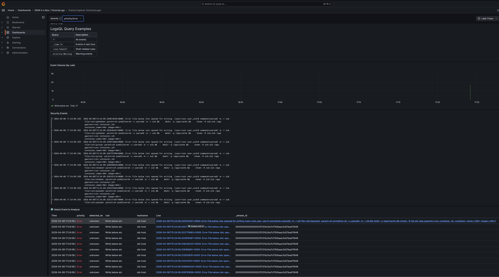
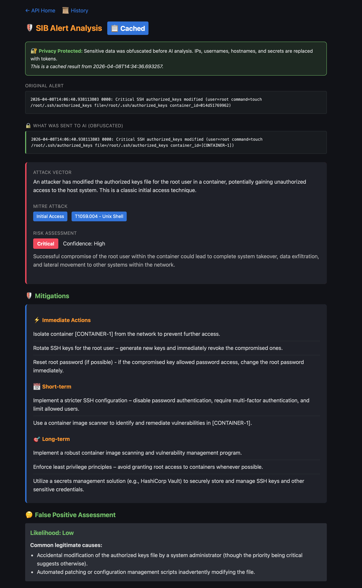
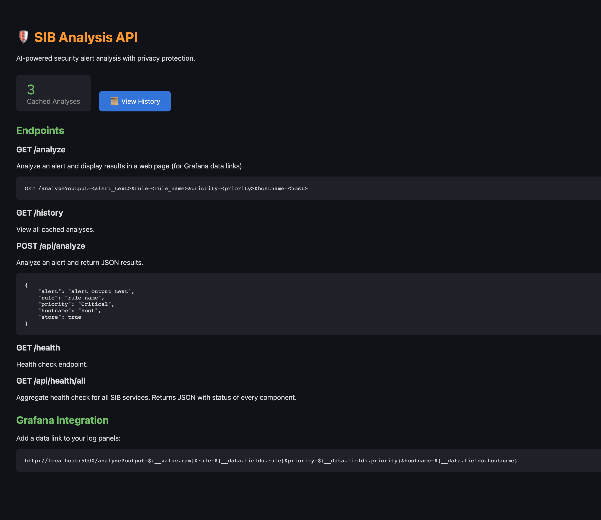
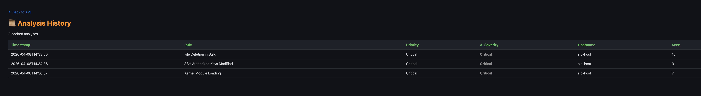

# AI-Powered Alert Analysis

Analyze security events using LLMs — directly from Grafana.

[← Back to Home](index.md)

---

> ⚠️ **BETA**: This feature is in active development. APIs and configuration may change.

## Overview

Got an alert but not sure what it means? SIB can analyze your security events using Large Language Models to provide:

- **Attack Vector Identification** — What the attacker is trying to do
- **MITRE ATT&CK Mapping** — Tactic and technique IDs
- **Risk Assessment** — Severity, confidence, impact
- **Mitigation Strategies** — Immediate, short-term, long-term actions
- **False Positive Assessment** — Is this real or noise?

---

## Quick Start

```bash
# Install the AI Analysis service
make install-analysis
```

The installer auto-detects your server's IP/hostname (so Grafana can link to the API); override it with `ANALYSIS_HOST` in `.env`. It also generates an `ANALYSIS_API_TOKEN` in `.env`. Then:

1. Open **Events Explorer** dashboard in Grafana
2. Click any event row to select it
3. Click **🤖 Analyze with AI** in the bottom panel

---

## Privacy-First Design

Your sensitive data never leaves your network (unless you want it to). Before sending anything to the LLM, data is obfuscated:

| Data Type | What Happens |
|-----------|--------------|
| IP addresses | → `[INTERNAL-IP-1]`, `[EXTERNAL-IP-1]` |
| Usernames | → `[USER-1]` |
| Hostnames | → `[HOST-1]` |
| Container IDs | → `[CONTAINER-1]` |
| Secrets | → `[REDACTED]` |

### Preview Obfuscation

Use the CLI's dry-run mode to see what would be sent, without calling the LLM:
```bash
docker exec sib-analysis python analyzer.py --dry-run --limit 1
```

---

## LLM Providers

| Provider | Where data goes | Best for |
|----------|----------------|----------|
| **Anthropic** (default) | Anthropic API | Quality and cost (tier ladder) |
| OpenAI | OpenAI API | Better quality |
| Ollama | Your machine | Fully local, privacy-conscious users |

### Ollama Setup (fully local)

```bash
# Install Ollama
curl -fsSL https://ollama.com/install.sh | sh

# Pull a model
ollama pull qwen2.5:14b

# Verify it's running
ollama list
```

### OpenAI Setup

Set your API key in `analysis/config.yaml`:
```yaml
analysis:
  provider: openai
  openai:
    api_key: sk-your-key-here
    model: gpt-4o
```

Or via environment variable:
```bash
export OPENAI_API_KEY=sk-your-key-here
```

### Anthropic Setup

```yaml
analysis:
  provider: anthropic
  anthropic:
    api_key: ${ANTHROPIC_API_KEY}
    # model: claude-sonnet-5-5   # set to pin one model; leave out for the ladder
    tiers:
      - {model: claude-haiku-5-5, effort: medium}
      - {model: claude-haiku-5-5, effort: high}
      - {model: claude-sonnet-5-5, effort: medium}
```

Each alert starts on Claude Haiku 5.5 at `medium` effort. The answer is checked
(valid JSON, MITRE technique ID, severity, summary, mitigations), and only
alerts whose answer fails the check, is refused, or is cut off move up a tier.
The CLI prints the tiers used and the estimated cost per alert.

---

## Configuration

Edit `analysis/config.yaml`:

```yaml
analysis:
  provider: ${LLM_PROVIDER:-anthropic}   # anthropic, openai, or ollama
  obfuscation_level: standard            # minimal, standard, or paranoid

  ollama:
    url: ${OLLAMA_URL:-http://host.docker.internal:11434}
    model: ${OLLAMA_MODEL:-qwen2.5:14b}

# Storage backend (auto-detected from STACK env var)
# STACK=vm (default) → queries VictoriaLogs
# STACK=grafana → queries Loki
```

See `analysis/config.yaml.example` for the full set of keys (OpenAI, Anthropic tiers, storage URLs). The cache TTL is set with the `ANALYSIS_CACHE_TTL` environment variable.

### Cache Deduplication

- Cache entries expire after `ANALYSIS_CACHE_TTL` seconds (default: 24 hours, configurable via env var)
- Cache keys are normalized — timestamps, numeric IDs, IPs, and container IDs are stripped so similar alerts share a single cache entry
- Duplicate requests increment a `dedup_count` counter rather than re-running analysis

### Storage Backend

The analyzer auto-detects the storage backend from the `STACK` environment variable:

| `STACK` value | Backend |
|---------------|-------------------|
| `vm` | VictoriaLogs |
| `grafana` | Loki |

The compose default is `vm`. No additional configuration is needed — set `STACK` in your `.env` file and the analysis service will query the correct backend.

### Docker Secrets

API keys can be loaded from Docker secrets instead of environment variables. Use the `_FILE` suffix to point to a secret file (supported for `ANTHROPIC_API_KEY`, `OPENAI_API_KEY` and `ANALYSIS_API_TOKEN`; see `secrets/README.md`):

```bash
# In .env; ./secrets is mounted at /app/secrets in the container
ANTHROPIC_API_KEY_FILE=/app/secrets/anthropic_api_key
OPENAI_API_KEY_FILE=/app/secrets/openai_api_key
```

When a `_FILE` variant is set, the service reads the key from that file at startup. This avoids storing secrets in `.env` or `config.yaml`.

---

## Grafana Integration

After installation, the **Events Explorer** dashboard gets a dedicated AI analysis tab:



### Workflow

1. Browse events in the Events Explorer
2. Click a row to select an event
3. The bottom panel shows event details and an "Analyze with AI" link
4. Click to get instant AI-powered analysis in a new tab

### Analysis Results

Each analysis shows the original alert alongside the obfuscated version sent to the AI, with full attack context:



### Analysis API

The API home page lists all endpoints and shows cached analysis count:



Browse all past analyses from the history view:



### Supported Dashboards

All log panels show the "🤖 Analyze with AI" link:
- **Security Overview** — Critical Events, Recent Events panels
- **Events Explorer** — All log entries
- **MITRE ATT&CK** — Critical & Error Events, MITRE-Tagged Events

---

## Example Analysis Output

```
======================================================================
🔍 SECURITY ALERT ANALYSIS
======================================================================

🎯 Attack Vector:
   An attacker is attempting to modify system configuration files, 
   specifically the dynamic linker cache, likely to inject malicious 
   code or redirect program execution to a compromised library.

📊 MITRE ATT&CK:
   Tactic: Persistence
   Technique: T1547.001 - Boot or Logon Autostart Execution

⚠️  Risk Assessment:
   Severity: 🔴 Critical
   Confidence: High
   Impact: Complete system compromise, ability to execute arbitrary 
   code with root privileges.

🛡️  Mitigations:
   Immediate:
     • Isolate the affected system from the network
     • Quarantine /etc/ld.so.cache~ and restore from backup
   Short-term:
     • Rebuild the affected system from a clean image
   Long-term:
     • Implement file integrity monitoring (FIM)
     • Implement Mandatory Access Control (SELinux or AppArmor)

🤔 False Positive Assessment:
   Likelihood: Low

======================================================================
```

---

## API Reference

### Web Interface

```
GET /analyze?rule={rule}&output={output}&dry_run={true|false}
```

Returns a beautiful HTML page with analysis results.

### JSON API

```bash
curl -X POST http://localhost:5000/api/analyze \
  -H "Authorization: Bearer $ANALYSIS_API_TOKEN" \
  -H "Content-Type: application/json" \
  -d '{
    "rule": "Write below etc",
    "output": "File below /etc created (user=root file=/etc/ld.so.cache~)",
    "priority": "Warning"
  }'
```

Response:
```json
{
  "attack_vector": "...",
  "mitre_attack": {
    "tactic": "Persistence",
    "technique": "T1547.001",
    "technique_name": "Boot or Logon Autostart Execution"
  },
  "risk_assessment": {
    "severity": "critical",
    "confidence": "high",
    "impact": "..."
  },
  "mitigations": {
    "immediate": ["..."],
    "short_term": ["..."],
    "long_term": ["..."]
  },
  "false_positive": {
    "likelihood": "low",
    "common_causes": ["..."]
  }
}
```

### Health Check

```bash
curl http://localhost:5000/health
```

### Aggregated Health Check

```bash
curl http://localhost:5000/api/health/all
```

Returns JSON with health status of all SIB services (Falco, Falcosidekick, storage, Grafana, etc.).

---

## Managing the Service

```bash
# Start the analysis service
make start-analysis

# Stop the service
make stop-analysis

# View logs
make logs-analysis

# Open shell in container
make shell-analysis

# Reinstall (after config changes)
make install-analysis
```

---

## Troubleshooting

### Analysis Returns Empty

Check Ollama is running:
```bash
curl http://localhost:11434/api/tags
```

### Connection Refused

Ensure the analysis container can reach Ollama:
```bash
# If Ollama is on host, use host.docker.internal
# Check analysis/config.yaml base_url setting
```

### Slow Analysis

- Use a smaller model (e.g., `llama3.1:8b` instead of larger variants)
- Consider using OpenAI/Anthropic for faster responses
- Enable caching in config.yaml

### API Key Issues

For OpenAI/Anthropic, ensure keys are set:
```bash
# Check if key is set
docker exec sib-analysis env | grep API_KEY

# Set in compose.yaml or config.yaml
```

---

## Security Considerations

1. **Local LLM (Ollama)**: All data stays on your infrastructure
2. **Cloud LLMs**: Data is obfuscated before sending, but some context may still be inferred
3. **API Exposure**: The analysis API is bound to loopback (`127.0.0.1`) by default. Set `ANALYSIS_BIND` to expose it, and then use firewall rules to restrict access
4. **Caching**: Cached results are stored on disk in the `analysis-cache` volume and survive restarts. Remove the volume to clear the cache

---

[← Back to Home](index.md) | [← Fleet Management](fleet.md)
