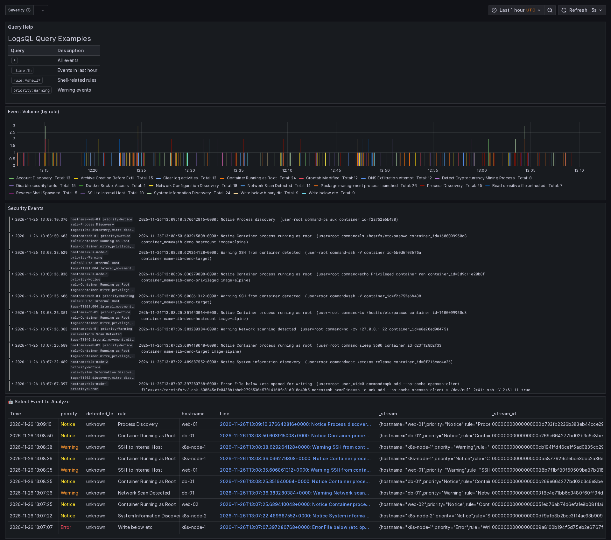
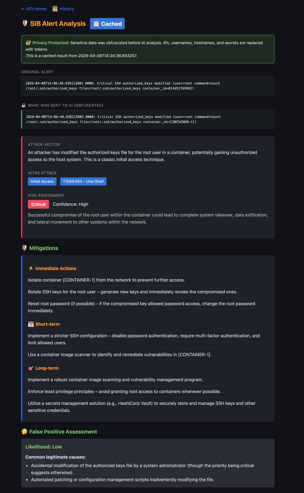
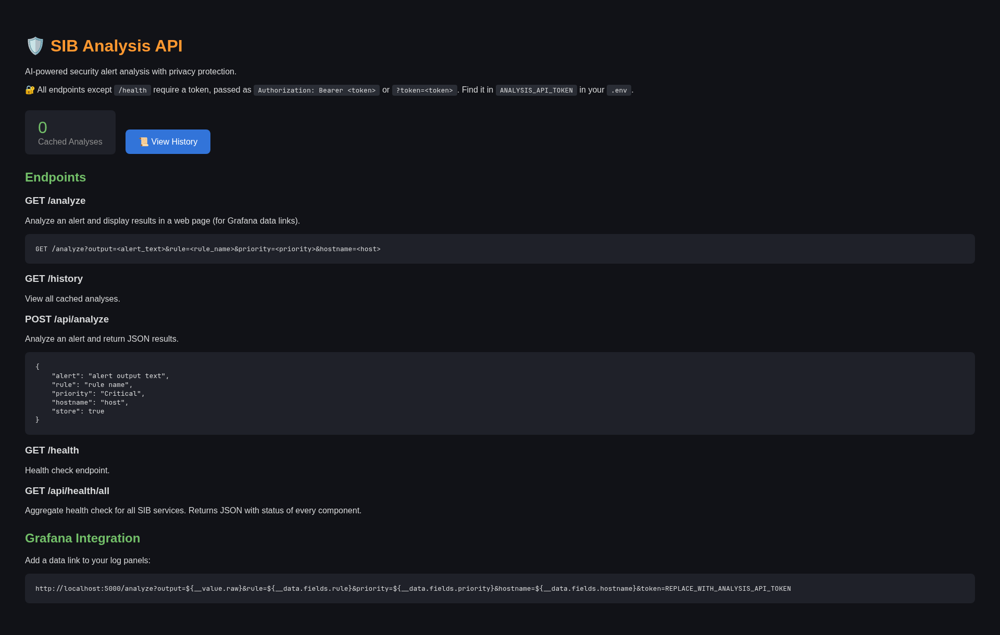
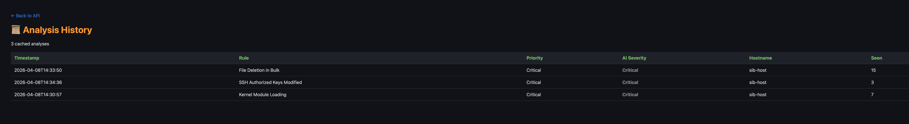

# AI-Powered Alert Analysis

Analyze security events using LLMs — directly from Grafana.

[← Back to Home](index.md)

---

> ⚠️ **BETA**: This feature is in active development. APIs and configuration may change.

## Overview

Got an alert but not sure what it means? SIB can analyze your security events using Large Language Models to provide:

- **Attack Vector Identification** — What the attacker is trying to do
- **MITRE ATT&CK Mapping** — Tactic and technique IDs
- **Risk Assessment** — Severity, confidence, impact
- **Mitigation Strategies** — Immediate, short-term, long-term actions
- **False Positive Assessment** — Is this real or noise?

---

## Quick Start

You need a running SIB install and, for the default provider, an Anthropic API key.

```bash
# In .env
ANTHROPIC_API_KEY=your-api-key
# Needed if your browser runs on another machine (see below)
ANALYSIS_BIND=0.0.0.0
```

```bash
make install-analysis
```

The installer generates `ANALYSIS_API_TOKEN` in `.env` if it is unset, writes the Events Explorer dashboard with links to the API, and restarts Grafana.

The links point at the server's auto-detected IP (override with `ANALYSIS_HOST` in `.env`). The API listens on `127.0.0.1` by default, so those links only work if you set `ANALYSIS_BIND=0.0.0.0`, or set `ANALYSIS_HOST=localhost` and browse from the server itself or through an SSH tunnel to port 5000.

Then:

1. Open the **Events Explorer** dashboard in Grafana
2. Click any event row to select it
3. Click **🤖 Analyze with AI** in the bottom panel

---

## Privacy

With a cloud provider (Anthropic is the default), the alert goes to that provider after obfuscation. Only Ollama keeps it on your own machines.

What is replaced depends on `obfuscation_level` in `analysis/config.yaml`:

| Data | Replaced with | `minimal` | `standard` (default) | `paranoid` |
|------|---------------|:---:|:---:|:---:|
| Secrets in known formats (cloud keys, tokens, `password=`, connection strings) | `[REDACTED-<TYPE>]` | yes | yes | yes |
| IP addresses | `[IP-INTERNAL-1]`, `[IP-EXTERNAL-1]` | no | yes | yes |
| E-mail addresses | `[EMAIL-1]` | no | yes | yes |
| Container IDs (12 or more hex characters) | `[CONTAINER-1]` | no | yes | yes |
| User names after `user=`, `uid=`, `User ` (`root` and common service accounts are kept) | `[USER-1]` | no | yes | yes |
| Dotted host names | `[HOST-1]` | no | no | yes |
| File names with an extension (sensitive paths are kept) | `[FILE].ext` | no | no | yes |
| Secret-like strings (long hex, base64, high entropy) | `[REDACTED-<TYPE>]` | no | no | yes |

Everything else is sent as is, including the rule name, priority, command lines and arguments. Single-label host names (`web-01`) are not replaced at any level, and neither are user names inside file paths.

### Preview Obfuscation

Use the CLI's dry-run mode to see what would be sent, without calling the LLM:
```bash
docker exec sib-analysis python analyzer.py --dry-run --limit 1
```

It takes the alerts from the last hour; use `--last 24h` to look further back.

---

## LLM Providers

| Provider | Where data goes | Best for |
|----------|----------------|----------|
| **Anthropic** (default) | Anthropic API | Quality and cost (tier ladder) |
| OpenAI | OpenAI API | Better quality |
| Ollama | Your machine | Fully local, privacy-conscious users |

### Ollama Setup (fully local)

```bash
# Install Ollama
curl -fsSL https://ollama.com/install.sh | sh

# Pull a model
ollama pull qwen2.5:14b

# Verify it's running
ollama list
```

Then set this in `.env` and run `make install-analysis`:

```bash
LLM_PROVIDER=ollama
OLLAMA_URL=http://192.0.2.10:11434   # an address the container can reach
OLLAMA_MODEL=qwen2.5:14b
```

The default URL, `http://host.docker.internal:11434`, points at the Docker host (the compose file maps it with `host-gateway`, so it works on Linux too). Ollama has to listen on an address the container can reach, not only on 127.0.0.1 (`OLLAMA_HOST=0.0.0.0` on the Ollama side; restrict access with a firewall). For Ollama on another machine, set `OLLAMA_URL` to its address.

### OpenAI Setup

In `.env`, then `make install-analysis`:

```bash
LLM_PROVIDER=openai
OPENAI_API_KEY=your-api-key
OPENAI_MODEL=gpt-4o        # default
```

### Anthropic Setup

Set `ANTHROPIC_API_KEY` in `.env`. The model ladder is in `analysis/config.yaml`:

```yaml
analysis:
  anthropic:
    api_key: ${ANTHROPIC_API_KEY}
    tiers:
      - {model: claude-haiku-5-5, effort: medium}
      - {model: claude-haiku-5-5, effort: high}
      - {model: claude-sonnet-5-5, effort: medium}
```

Each alert starts on Claude Haiku 5.5 at `medium` effort. The answer is checked
(valid JSON, MITRE technique ID, severity, summary, mitigations), and only
alerts whose answer fails the check, is refused, or is cut off move up a tier.
The CLI prints the tiers used and the estimated cost per alert. With `--json`,
the same record (tiers tried, tokens, estimated cost) is in the `llm` field.
The API does not return it.

To use one model for everything, delete the `tiers` list from
`analysis/config.yaml`, set `ANTHROPIC_MODEL` (and optionally
`ANTHROPIC_EFFORT`, default `medium`) in `.env`, and run
`make install-analysis` and `make restart-analysis`. While `tiers` is present,
`ANTHROPIC_MODEL` has no effect.

---

## Configuration

Set these in `.env`, then run `make install-analysis`:

| Variable | Default | Purpose |
|----------|---------|---------|
| `LLM_PROVIDER` | `anthropic` | `anthropic`, `openai` or `ollama` |
| `ANTHROPIC_API_KEY` | | Anthropic key |
| `ANTHROPIC_MODEL`, `ANTHROPIC_EFFORT` | empty, `medium` | Pin one model (see [Anthropic Setup](#anthropic-setup)) |
| `OPENAI_API_KEY`, `OPENAI_MODEL` | model `gpt-4o` | OpenAI |
| `OLLAMA_URL`, `OLLAMA_MODEL` | `http://host.docker.internal:11434`, `qwen2.5:14b` | Ollama |
| `ANALYSIS_API_TOKEN` | generated | Required by every endpoint except `/health` |
| `ANALYSIS_BIND` | `127.0.0.1` | Address the API is published on |
| `ANALYSIS_PORT` | `5000` | Published port |
| `ANALYSIS_HOST` | auto-detected | Host name or IP used in the Grafana links |
| `ANALYSIS_CORS_ORIGINS` | none | Comma-separated origins allowed to call the API cross-origin |
| `AIB_BASE_URL`, `AIB_API_TOKEN` | empty | [Asset context from AIB](aib-integration.md) |
| `STACK` | `vm` | Storage backend, see below |

The obfuscation level is set in `analysis/config.yaml` (`obfuscation_level: minimal`, `standard` or `paranoid`). After editing that file, run `make restart-analysis`.

### Cache Deduplication

The cache applies to `GET /analyze`, which the Grafana link uses. The JSON API and the CLI call the model every time.

- Cache entries expire after `ANALYSIS_CACHE_TTL` seconds (default: 24 hours; set it in `.env`)
- Cache keys are normalized: timestamps, numeric IDs, IPs, and container IDs are stripped so similar alerts share a single cache entry
- Duplicate requests increment a `dedup_count` counter rather than re-running analysis
- A failed analysis is cached too (see [Troubleshooting](#troubleshooting))

### Storage Backend

The analyzer picks the storage backend from the `STACK` variable in `.env`:

| `STACK` value | Backend |
|---------------|-------------------|
| `vm` (default) | VictoriaLogs |
| `grafana` | Loki |

### Docker Secrets

API keys can be read from files instead of environment variables. Use the `_FILE` suffix to point to a secret file (supported for `ANTHROPIC_API_KEY`, `OPENAI_API_KEY` and `ANALYSIS_API_TOKEN`; see `secrets/README.md` in the repository):

```bash
# In .env; ./secrets is mounted at /app/secrets in the container
ANTHROPIC_API_KEY_FILE=/app/secrets/anthropic_api_key
OPENAI_API_KEY_FILE=/app/secrets/openai_api_key
```

When a `_FILE` variant is set, the service reads the key from that file at startup.

With `ANALYSIS_API_TOKEN_FILE` set, `make install-analysis` reads the token for the Grafana links from that file (`/app/secrets/<name>` in the container is `./secrets/<name>` on the host).

---

## Grafana Integration

After installation, the **Events Explorer** dashboard gets an AI analysis panel:



### Workflow

1. Browse events in the Events Explorer
2. Click a row to select an event
3. The bottom panel shows event details and an "Analyze with AI" link
4. Click to get instant AI-powered analysis in a new tab

### Analysis Results

Each analysis shows the original alert and, if anything was replaced, the obfuscated version sent to the AI:



### Analysis API

The API home page lists all endpoints and shows cached analysis count:



Browse all past analyses from the history view:



### Supported Dashboards

Only the **Events Explorer** dashboard has the "🤖 Analyze with AI" link.

---

## Example Analysis Output

```
======================================================================
🔍 SECURITY ALERT ANALYSIS
======================================================================

🎯 Attack Vector:
   An attacker is attempting to modify system configuration files, 
   specifically the dynamic linker cache, likely to inject malicious 
   code or redirect program execution to a compromised library.

📊 MITRE ATT&CK:
   Tactic: Persistence
   Technique: T1547.001 - Boot or Logon Autostart Execution

⚠️  Risk Assessment:
   Severity: 🔴 Critical
   Confidence: High
   Impact: Complete system compromise, ability to execute arbitrary 
   code with root privileges.

🛡️  Mitigations:
   Immediate:
     • Isolate the affected system from the network
     • Quarantine /etc/ld.so.cache~ and restore from backup
   Short-term:
     • Rebuild the affected system from a clean image
   Long-term:
     • Implement file integrity monitoring (FIM)
     • Implement Mandatory Access Control (SELinux or AppArmor)

🤔 False Positive Assessment:
   Likelihood: Low

======================================================================
```

---

## API Reference

Every endpoint except `/health` needs `ANALYSIS_API_TOKEN`, as an `Authorization: Bearer` header or a `token=` query parameter.

| Endpoint | Method | Description |
|----------|--------|-------------|
| `/` | GET | API home page |
| `/analyze` | GET | HTML result page |
| `/api/analyze` | POST | JSON API |
| `/history`, `/history/<id>` | GET | Cached analyses (HTML) |
| `/api/history?limit=50` | GET | Cached analyses (JSON) |
| `/api/health/all` | GET | Health of SIB services |
| `/health` | GET | Health check, no token |

The examples run from the repository root:

```bash
TOKEN=$(grep '^ANALYSIS_API_TOKEN=' .env | cut -d= -f2)
```

### Web Interface

```
GET /analyze?output={alert text}&rule={rule}&priority={priority}&hostname={host}
```

Returns an HTML page with the analysis. The result is cached and, unless you add `store=false`, written to the log storage. `show_mapping=true` adds the table of replaced values.

### JSON API

The alert text goes in `alert`. `priority`, `hostname` and `store` (default `false`) are optional.

```bash
curl -X POST http://localhost:5000/api/analyze \
  -H "Authorization: Bearer $TOKEN" \
  -H "Content-Type: application/json" \
  -d '{
    "rule": "Write below etc",
    "alert": "File below /etc created (user=root file=/etc/ld.so.cache~)",
    "priority": "Warning"
  }'
```

Response:
```json
{
  "success": true,
  "analysis": {
    "attack_vector": "...",
    "mitre_attack": {
      "tactic": "Persistence",
      "technique_id": "T1547.001",
      "technique_name": "Boot or Logon Autostart Execution",
      "sub_technique": null
    },
    "risk": {"severity": "Critical", "confidence": "High", "impact": "..."},
    "investigate": ["..."],
    "mitigations": {"immediate": ["..."], "short_term": ["..."], "long_term": ["..."]},
    "false_positive": {"likelihood": "Low", "common_causes": ["..."], "distinguishing_factors": ["..."]},
    "summary": "..."
  },
  "obfuscation_mapping": {"ips": {}, "users": {}, "secrets_count": 0},
  "aib_context": {}
}
```

If the model call fails, the response still says `"success": true` and `analysis` holds an `error` message.

### Health Checks

```bash
curl http://localhost:5000/health

# Falcosidekick, storage, Grafana and the API itself
curl -H "Authorization: Bearer $TOKEN" http://localhost:5000/api/health/all
```

---

## Managing the Service

```bash
make start-analysis       # Start the service
make stop-analysis        # Stop the service
make restart-analysis     # Restart (picks up config.yaml changes)
make logs-analysis        # View logs
make shell-analysis       # Open a shell in the container
make install-analysis     # Rebuild; applies .env changes
make uninstall-analysis   # Remove the service and its cache volume
```

---

## Troubleshooting

### Analysis Shows N/A or an Error

The model call failed. The CLI prints the error:

```bash
docker exec sib-analysis python analyzer.py --limit 1 --last 24h
```

The web page caches the failed result as well. To clear the cache after fixing the cause (this removes the history):

```bash
make uninstall-analysis
make install-analysis
```

### Ollama Not Reachable

Check that Ollama is running, then check `OLLAMA_URL` in `.env` (see [Ollama Setup](#ollama-setup-fully-local)):
```bash
curl http://localhost:11434/api/tags
```

### Grafana Link Does Not Open or Returns 401

If the browser can't connect, see the note on `ANALYSIS_BIND` and `ANALYSIS_HOST` in [Quick Start](#quick-start). On 401, run `make install-analysis` again to rewrite the links with the current token.

### Slow Analysis

- Use a smaller model (for example `llama3.1:8b`)
- Consider OpenAI or Anthropic for faster responses

### API Key Issues

```bash
# Check which key variables are set (this prints the values)
docker exec sib-analysis env | grep API_KEY
```

Set keys in `.env`, then run `make install-analysis`.

---

## Security Considerations

1. **Local LLM (Ollama)**: Alerts stay on your infrastructure
2. **Cloud LLMs**: Obfuscation is pattern-based. Check the dry run before relying on it
3. **API Exposure**: The API is published on loopback (`127.0.0.1`) by default. If you set `ANALYSIS_BIND` to expose it, restrict access with firewall rules; it serves plain HTTP
4. **Token in dashboards**: The Grafana links contain the API token, so anyone who can view the Events Explorer can read it
5. **Caching**: Cached results, including the original alert text, are stored in the `analysis-cache` volume and survive restarts. `make uninstall-analysis` removes it

---

[← Back to Home](index.md) | [← Fleet Management](fleet.md)
