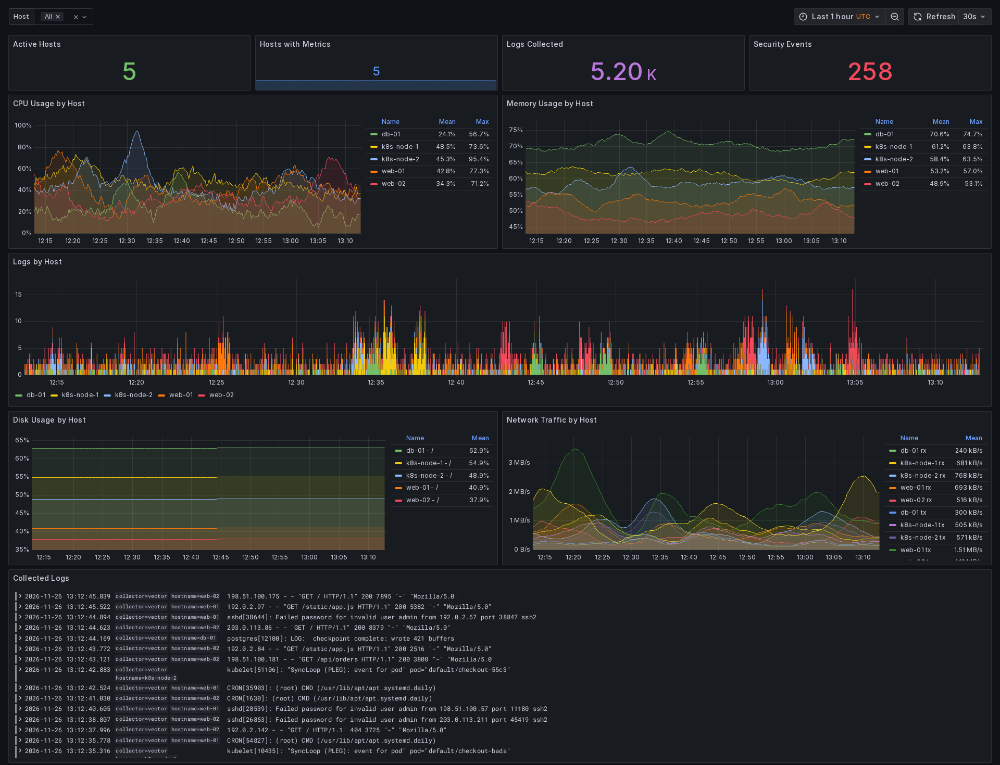

# Fleet Management

Deploy and manage SIB security agents across your infrastructure.

[← Back to Home](index.md)

---

## Overview

SIB includes Ansible-based fleet management to deploy security agents across multiple hosts. **No local Ansible installation required** — it runs in Docker.

```
┌─────────────────────────────────────────────────────────┐
│                    SIB Central Server                    │
│  ┌─────────┐ ┌──────────────┐ ┌────────────────┐        │
│  │ Grafana │ │ VictoriaLogs │ │ VictoriaMetrics│        │
│  └─────────┘ └──────────────┘ └────────────────┘        │
└─────────────────────────▲──────────────▲────────────────┘
                          │              │
     ┌────────────────────┼──────────────┼────────────────┐
     │   Host A           │   Host B     │   Host C       │
     │ Falco + collectors ┴──────────────┴─── ...         │
     └────────────────────────────────────────────────────┘
```

Each fleet host gets:
- **Falco** — Runtime security detection (events sent directly to Falcosidekick)
- **VM stack (default):** Vector (logs → VictoriaLogs) + vmagent + node_exporter (metrics → VictoriaMetrics)
- **Grafana stack:** Alloy (logs → Loki, metrics → Prometheus)

All events from all hosts appear in your central Grafana dashboards.

---

## Deployment Strategies

SIB supports both **native packages** and **Docker containers**:

| Strategy | Description |
|----------|-------------|
| `docker` | Run agents as containers, installing Docker if it is missing. **Recommended for simplicity.** |
| `native` | Falco from the Falco package repo as a systemd service (Grafana stack: Alloy as a binary) |
| `auto` (default) | Docker, installing it if it is missing; native only if Docker is missing and `install_docker_if_missing: false` |

> **Note:** VM stack collectors (Vector, vmagent, node_exporter) always run as Docker containers regardless of strategy. `native` doesn't install Docker, so on the VM stack install it first (`make fleet-docker-check`).

> ⚠️ **LXC Limitation:** Falco cannot run in LXC containers due to kernel access restrictions. Use VMs or run Falco on the LXC host itself.

---

## Quick Start

### 1. Configure Inventory

```bash
# Copy example inventory
cp ansible/inventory/hosts.yml.example ansible/inventory/hosts.yml

# Edit with your hosts
vim ansible/inventory/hosts.yml
```

Example inventory:
```yaml
all:
  vars:
    sib_server: 192.168.1.100  # REQUIRED: Your SIB server IP
    ansible_user: ubuntu
    ansible_ssh_private_key_file: ~/.ssh/id_rsa
    
  children:
    fleet:
      vars:
        # Fleet hosts need sudo for installing/managing services
        ansible_become: true
      hosts:
        webserver:
          ansible_host: 192.168.1.10
        database:
          ansible_host: 192.168.1.11
        appserver:
          ansible_host: 192.168.1.12
```

> **Important:** Place `ansible_become: true` under `fleet.vars`, **not** at the top-level `all.vars`. Ansible runs some tasks locally (inside the Ansible container), and setting `become` globally would cause those tasks to fail with "sudo: not found".

### 2. Enable Remote Access on SIB Server

Fleet agents need to reach the storage endpoints and Falcosidekick on the SIB server. By default, both only listen on localhost.

```bash
# On the SIB server
make enable-remote
```

This sets `STORAGE_BIND=0.0.0.0` in `.env` and recreates storage containers so VictoriaLogs (9428) and VictoriaMetrics (8428) — or Loki (3100) and Prometheus (9090) for the Grafana stack — accept remote connections.

It does not expose Falcosidekick, which receives the fleet's Falco events. Set this in `.env`:

```bash
SIDEKICK_BIND_ADDR=0.0.0.0
```

and apply it with `make install-alerting`. Restrict the exposed ports with a [firewall](#firewall-configuration), and use [mTLS](#enable-mtls-for-encrypted-fleet-communication) on port 2801.

### 3. Test Connectivity

```bash
make fleet-ping
```

### 4. Deploy to Fleet

```bash
# Deploy to all hosts (auto: Docker, installed if missing)
make deploy-fleet

# Or target specific hosts
make deploy-fleet LIMIT=webserver

# Force Docker deployment instead of native
make deploy-fleet ARGS="-e deployment_strategy=docker"
```

---

## Fleet Commands

| Command | Description |
|---------|-------------|
| `make deploy-fleet` | Deploy Falco + collectors to all fleet hosts |
| `make update-rules` | Push custom rules to fleet |
| `make generate-fleet-certs` | Generate client certificates for every host in the inventory |
| `make fleet-certs` | Push mTLS certificates to fleet hosts without a full redeploy |
| `make fleet-health` | Check health of all agents |
| `make fleet-docker-check` | Check/install Docker on fleet hosts |
| `make fleet-ping` | Test SSH connectivity |
| `make fleet-shell` | Open shell in Ansible container |
| `make remove-fleet` | Remove agents from fleet (no confirmation prompt) |
| `make refresh-alerts` | Update the hosts the Falco liveness alert expects (after editing the inventory) |

---

## Configuration Options

Edit `ansible/inventory/group_vars/all.yml` to customize deployment:

<!--  -->
```yaml
# Stack type: vm (default) or grafana
sib_stack: vm

# Deployment strategy: auto, docker, or native
deployment_strategy: auto

# Falco settings
falco_version: "0.45.2"   # 0.44+ required; keep in sync with FALCO_VERSION in .env
falco_priority: notice
# Rule files pushed from detection/config/rules/
falco_custom_rules:
  - custom_rules.yaml

# Docker network name (must match SIB server's network)
docker_network: sib-network

# SIB server endpoints (VM stack — default, auto-derived from sib_server)
sib_victorialogs_url: "http://{{ sib_server }}:9428"
sib_victoriametrics_url: "http://{{ sib_server }}:8428"

# mTLS for Falco → Falcosidekick
mtls_enabled: false
mtls_cert_dir: /etc/sib/certs
```
<!--  -->

Per-host variables in the inventory include `deployment_strategy`, `sib_expected` (see [Falco liveness](#falco-liveness-alert)) and `hib_events_dir` (ship [HIB](hib-integration.md) events).

> **Important:** `sib_server` must be set in your inventory file (`ansible/inventory/hosts.yml`) under `all.vars`. There is no default — deployments will fail without it.

---

## Remote Access Details

As described in the Quick Start, `make enable-remote` exposes storage endpoints. Here's what it changes and how to secure it.

### Firewall Configuration

Restrict ports 2801, 9428 and 8428 (Grafana stack: 2801, 3100, 9090) to fleet nodes only. Docker-published ports bypass `ufw` and the `INPUT` chain, so filter in Docker's `DOCKER-USER` chain or on a firewall in front of the host. [Security Hardening](security-hardening.md#4-restrict-fleet-ingress) has the commands.

---

## Enable mTLS for Encrypted Fleet Communication

For production deployments, enable mutual TLS (mTLS) for Falco events. It covers:
- **Falco → Falcosidekick** (port 2801): events sent over HTTPS with client certificates

Collector traffic to storage (logs and metrics) stays plain HTTP: restrict it with firewall rules.

### Quick mTLS Setup

> **Fresh Install?** If setting up a new SIB server with mTLS from the start:
> ```bash
> [ -f .env ] || cp .env.example .env
> sed -i 's/MTLS_ENABLED=false/MTLS_ENABLED=true/' .env
> make generate-certs
> make install
> ```

For existing SIB installations:

```bash
# 1. Generate CA and server certificates
make generate-certs

# 2. Generate client certificates for all fleet hosts
#    (reads hostnames from ansible/inventory/hosts.yml)
make generate-fleet-certs

# 3. Enable mTLS on SIB server
sed -i 's/MTLS_ENABLED=false/MTLS_ENABLED=true/' .env

# 4. Regenerate Falcosidekick config with mTLS and restart
make install-alerting

# 5. Regenerate Falco config with mTLS and restart
make install-detection

#    Re-run the storage target too, so VictoriaMetrics/Prometheus scrape
#    Falcosidekick over https with their own client certificate
make install-storage-vm        # or install-storage-grafana

# 6. Enable mTLS in Ansible group_vars
#    Edit ansible/inventory/group_vars/all.yml:
#    mtls_enabled: true

# 7. Deploy fleet with mTLS certificates
make deploy-fleet
```

> **Certificate inventory format:** The `make generate-fleet-certs` command parses your `ansible/inventory/hosts.yml` and supports both flat and nested inventory formats (e.g., `fleet:` at root level or under `all.children.fleet.hosts`). It skips host names containing dots (use `make generate-client-cert HOST=<name>` for those) and may create unused certificates named after per-host variables.

> **Falco driver note:** Fleet hosts use the `modern_ebpf` driver, which needs kernel 5.8 or later. No manual driver configuration is needed.

### Per-Host Certificate Generation

If you add a new host later:

```bash
# Generate certificate for the new host
make generate-client-cert HOST=new-server

# Deploy to just that host
make deploy-fleet LIMIT=new-server
```

### Verify mTLS is Working

```bash
# Check Falcosidekick logs for TLS connections
docker logs sib-sidekick 2>&1 | grep -i tls

# Test mTLS connection manually
openssl s_client -connect localhost:2801 \
  -CAfile certs/ca/ca.crt \
  -cert certs/clients/local.crt \
  -key certs/clients/local.key
```

See [Security Hardening](security-hardening.md) for complete mTLS documentation.

---

## Manual Collector Deployment

If you prefer manual deployment without Ansible. This deploys only the log and metric collectors: no Falco, and no Falco liveness metrics.

### Using Deploy Script

```bash
# Deploy to a single host (uses this server's first IP address)
make deploy-collector HOST=user@remote-host

# Or directly: remote host, then SIB server IP
./collectors/scripts/deploy.sh user@192.0.2.50 192.0.2.10
```

The script copies the collector configuration to `~/sib-collector` on the remote host and starts it with Docker Compose, using the `STACK` from your `.env`.

On the VM stack it also writes `SIB_SERVER` to `~/sib-collector/.env`, which vmagent uses for its remote-write address.

### Full Manual Setup (VM Stack)

Run from the SIB directory, with your SIB server's IP in place of `192.0.2.10`:

```bash
ssh user@remote-host "mkdir -p ~/sib-collector/config"

# Copy configs and compose file
scp collectors/config/vector.toml collectors/config/vmagent.yml user@remote-host:~/sib-collector/config/
scp collectors/compose-vm.yaml user@remote-host:~/sib-collector/compose.yaml

# Set the server address and start the collectors
ssh user@remote-host 'cd ~/sib-collector && echo "SIB_SERVER=192.0.2.10" > .env && HOSTNAME=$(hostname) docker compose up -d'
```

Logs from these manual VM collectors carry a `host` field, not `hostname`, so the Fleet Overview log panels don't include them.

---

## What Gets Collected

By Ansible-deployed hosts on the VM stack (default):

| Type | Sources | Labels/Fields |
|------|---------|---------------|
| **System Logs** | `/var/log/syslog`, `/var/log/messages` | `hostname` field |
| **Auth Logs** | `/var/log/auth.log`, `/var/log/secure` | `hostname` field |
| **Kernel Logs** | `/var/log/kern.log` | `hostname` field |
| **Docker Logs** | All containers | `hostname` field, `container_name` |
| **Node Metrics** | CPU, memory, disk, network | `host` label, `job="node"` |
| **Falco Events** | Security detections | `hostname` field (via Falcosidekick) |
| **Falco Metrics** | Falco's `/metrics` on `127.0.0.1:8765`, scraped by the local collector | `host` label, `job="falco"` (drives the [liveness alert](#falco-liveness-alert)) |

Data labeling convention:
- **Metrics** (VictoriaMetrics): tagged with `host` label (set by vmagent's `-remoteWrite.label`)
- **Logs** (VictoriaLogs): tagged with `hostname` field (set by Vector transform)
- **Falco events**: tagged with `hostname` field (set by Falcosidekick)

On the Grafana stack, Alloy ships the systemd journal and Docker logs (not the `/var/log` files), labelled `host`.

---

## Verifying Fleet Deployment

### Check Collector Status

```bash
# VM stack (default) — check Vector and vmagent
ssh user@remote "docker logs sib-vector --tail 20"
ssh user@remote "docker logs sib-vmagent --tail 20"

# Grafana stack — check Alloy
ssh user@remote "docker logs sib-alloy --tail 20"
```

### Verify Data in SIB

```bash
# Query VictoriaLogs for collector data (default stack)
curl -s "http://localhost:9428/select/logsql/query?query=*" | head

# Check metrics in VictoriaMetrics (default stack)
curl -s 'http://localhost:8428/api/v1/query?query=node_uname_info'

# Grafana stack: the same check in Prometheus
curl -s 'http://localhost:9090/api/v1/query?query=node_uname_info'
```

### Fleet Overview Dashboard

Open Grafana and navigate to **Dashboards** → **Fleet Overview**:



This shows:
- Number of active hosts with collectors
- CPU, memory, disk utilization per host
- Network traffic graphs
- Log volume by host
- Hostname selector to filter all panels

---

## Falco Liveness Alert

Every host in the `fleet` group is expected to report Falco metrics. If one
stops (Falco or its collector down, host offline), Grafana fires **Falco not
reporting** until it is back, however long that takes. `make deploy-fleet`
keeps the expected list in sync with the inventory. To retire a host, remove it
from `inventory/hosts.yml` and run `make refresh-alerts`; for a host that runs
no Falco, set `sib_expected: false`. See
[Grafana Alerts](grafana-alerts.md#falco-liveness).

## Updating Fleet

### Push Rule Updates

```bash
make update-rules
```

This pushes custom rules from `detection/config/rules/` to all fleet hosts.

It copies only the files listed in `falco_custom_rules` (default: `custom_rules.yaml`), validates
them together with Falco's `falco_rules.yaml`, and restarts Falco (the `sib-falco` container
on Docker hosts, the systemd service on native hosts).

> **Upgrading:** Docker hosts deployed before custom rules were mounted at
> `/etc/falco/rules.d` never loaded them. `make update-rules` stops on such a host and
> asks for a one-time `make deploy-fleet LIMIT=<host>`.

### Health Check

```bash
make fleet-health
```

Checks:
- Falco is running
- Collector containers are up (vmagent/node_exporter on the VM stack, Alloy on the Grafana stack); Vector isn't checked, and neither is data arriving
- VictoriaMetrics (or Loki) and Falcosidekick are reachable from the host

---

## Troubleshooting

### SSH Connection Issues

```bash
# Test SSH manually
ssh -i ~/.ssh/id_rsa user@remote-host

# Check SSH key permissions
chmod 600 ~/.ssh/id_rsa

# Test via Ansible
make fleet-ping
```

### Falco Not Starting

```bash
# Check kernel version on remote host (need >= 5.8 for modern_ebpf)
ssh user@remote "uname -r"

# Check Falco logs
ssh user@remote "docker logs sib-falco"
# Or for native install
ssh user@remote "journalctl -u falco-modern-bpf -n 50"   # or -u falco
```

> **Common issue:** If Falco enters a restart loop, check the kernel version: fleet hosts use `modern_ebpf`, which needs 5.8 or later.

### Ansible "sudo: not found" Error

This happens when `ansible_become: true` is set globally (under `all.vars`). Some tasks run locally inside the Ansible container, which doesn't have sudo. Move `ansible_become: true` to the fleet group:

```yaml
# Wrong — causes errors on local tasks
all:
  vars:
    ansible_become: true   # ← Don't put it here

# Correct — only applies to fleet hosts
fleet:
  vars:
    ansible_become: true   # ← Put it here
```

### No Data in Grafana

1. **Check storage is externally accessible:**
   ```bash
   # From a fleet host, test connectivity to VM stack endpoints
   curl -s http://SIB_SERVER:9428/health      # VictoriaLogs
   curl -s http://SIB_SERVER:8428/health      # VictoriaMetrics
   curl -s http://SIB_SERVER:2801/healthz     # Falcosidekick (https with mTLS)
   ```
   
   If storage fails, run `make enable-remote` on the SIB server to set `STORAGE_BIND=0.0.0.0`. If Falcosidekick fails, set `SIDEKICK_BIND_ADDR=0.0.0.0` in `.env` and run `make install-alerting`.

2. **Check collectors are running:**
   ```bash
   # VM stack (default)
   ssh user@remote "docker ps | grep -E 'sib-(vector|vmagent|node-exporter)'"
   # Grafana stack
   ssh user@remote "docker ps | grep alloy"
   ```

3. **Check collector logs for errors:**
   ```bash
   ssh user@remote "docker logs sib-vector --tail 50"
   ssh user@remote "docker logs sib-vmagent --tail 50"
   ```

4. **Verify Falcosidekick is receiving events (on SIB server):**
   ```bash
   docker logs sib-sidekick --tail 20 2>&1 | grep -E "POST|Loki|Victoria"
   ```
   
   You should see `POST OK (204)` messages if events are flowing.

---

## Removing Fleet Agents

```bash
# Remove from all hosts
make remove-fleet

# Remove from specific host
make remove-fleet LIMIT=webserver
```

The target runs right away, without asking. It removes:
- Native Falco and Alloy, and their configuration
- The `sib-alloy`, `sib-vmagent` and `sib-node-exporter` containers
- The SIB directories (`/etc/sib`, `/etc/sib-collector`)

It leaves the `sib-falco` and `sib-vector` containers running. Remove them on each host:

```bash
ssh user@remote "docker rm -f sib-falco sib-vector"
```

---

[← Back to Home](index.md) | [AI Analysis →](ai-analysis.md)
